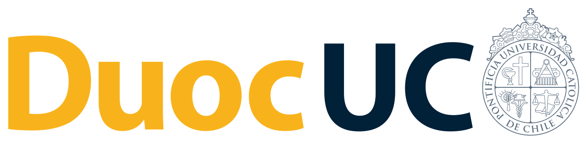
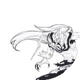
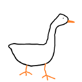

<div align="center">
  <br>
  
  <p><strong>LUM Natural Care · Sistema Integrado de Gestión</strong></p>

  <p>
    
    
    
    
    <br>
    <a href="https://github.com/lum-management-system">
      
    </a>
  </p>
</div>

> Repositorio académico del proyecto de título de Ingeniería en Informática de Duoc UC.

LUM Natural Care es un proyecto de transformación digital para una marca chilena de cuidado personal elaborada con ingredientes de origen natural. La solución contempla un **sistema integrado de gestión** con capacidades de **CRM** y **ERP**, respaldado por una arquitectura web moderna y una organización de trabajo basada en metodologías ágiles.

El proyecto es desarrollado por el equipo 7 **BeNicAl**.

---

## Contenido

- [Sobre el proyecto](#sobre-el-proyecto)
- [Cliente](#cliente)
- [Equipo](#equipo)
- [Arquitectura y stack tecnológico](#arquitectura-y-stack-tecnológico)
- [Organización del ecosistema](#organización-del-ecosistema)
- [Estructura de este repositorio](#estructura-de-este-repositorio)
- [Cómo encontrar la documentación](#cómo-encontrar-la-documentación)
- [Principios de diseño](#principios-de-diseño)
- [Documentación relacionada](#documentación-relacionada)
- [Contribuidores](#contribuidores)

## Sobre el proyecto

El objetivo de LUM Natural Care es centralizar y mejorar la gestión de los procesos comerciales y operativos de la marca mediante una plataforma integrada. El alcance se organiza en dos áreas principales:

- **CRM:** gestión de clientes y relación comercial.
- **ERP:** gestión de inventario y pedidos.

Este repositorio reúne los antecedentes académicos, entregables y documentación asociados al desarrollo del proyecto durante el Capstone 2026.

### Módulos principales

- **Inventario base:** productos, insumos, existencias y movimientos de stock.
- **CRM:** clientes, historial de compras y seguimiento comercial.
- **Cotizaciones:** precios detallistas y mayoristas, cálculo de IVA y generación de documentos PDF.
- **Seguimiento postventa:** registro de pedidos y atención posterior a la compra.
- **Sincronización comercial:** recepción de ventas desde Shopify mediante webhooks.
- **Interfaz integrada:** operación centralizada con identidad visual de LUM Natural Care.

## Cliente

**LUM Natural Care** es una marca chilena de cuidado personal que formula sus productos exclusivamente con ingredientes de origen natural.

| Canal | Enlace |
|---|---|
| Sitio web | [lumnaturalcare.cl](https://lumnaturalcare.cl) |
| Instagram | [@lumnaturalcare](https://www.instagram.com/lumnaturalcare) |
| TikTok | [@lumnaturalcare](https://www.tiktok.com/@lumnaturalcare) |

## Equipo

| Integrante | Responsabilidad |
|---|---|
| Alexis Margas | Product Owner |
| Benjamín González | Scrum Master |
| Nicolás Díaz | Development Team |

## Arquitectura y stack tecnológico

La solución se organiza como una aplicación web separada en frontend, backend y servicios de persistencia:

| Capa | Tecnología | Propósito |
|---|---|---|
| Frontend | React 19 y Vite | Construcción de la interfaz web |
| Backend | NestJS y Fastify | API REST y lógica de negocio |
| Base de datos | PostgreSQL sobre Supabase | Persistencia y gestión de datos |
| Despliegue | Render | Publicación de los componentes de la solución |
| Control de versiones | GitHub | Colaboración y control de cambios |
| Gestión de trabajo | Azure DevOps | Seguimiento de historias de usuario y planificación |

### Tecnologías principales

<p align="center">
  <a href="https://react.dev/">
    
  </a>
  <a href="https://vite.dev/">
    
  </a>
  <a href="https://nestjs.com/">
    
  </a>
  <a href="https://www.postgresql.org/">
    
  </a>
  <a href="https://supabase.com/">
    
  </a>
  <a href="https://render.com/">
    
  </a>
</p>

## Organización del ecosistema

El desarrollo técnico se encuentra organizado en la organización de GitHub [**lum-management-system**](https://github.com/lum-management-system), que contiene tres repositorios complementarios:

| Repositorio | Descripción | Enlace |
|---|---|---|
| `api` | Código fuente del backend y la API REST | [lum-management-system/api](https://github.com/lum-management-system/api) |
| `web` | Código fuente del frontend | [lum-management-system/web](https://github.com/lum-management-system/web) |
| `documentos` | Informes, mockups y documentación de arquitectura | [lum-management-system/documentos](https://github.com/lum-management-system/documentos) |

## Estructura de este repositorio

```text
.
├── Actividades/
│   ├── FASE 1/
│   │   ├── Alexis Margas Arce/
│   │   ├── Benjamin Gonzalez Araya/
│   │   ├── Nicolas Diaz Pavez/
│   ├── FASE 2/
│   │   ├── Alexis Margas Arce/
│   │   ├── Benjamin Gonzalez Araya/
│   │   ├── Nicolas Diaz Pavez/
│   │   └── General-Equipo-7/
│   └── FASE 3/
│       └── Benjamin Gonzalez Araya/
├── Documentos/
│   ├── Mockups/              # Propuestas visuales del sistema
│   ├── Presentaciones/       # Presentaciones de avance por fase
│   └── Recursos/
│       ├── Equipo/
│       └── Logos/            # Logos de LUM y Duoc UC
└── README.md
```

### Criterio de organización

- `Actividades/` contiene el trabajo académico organizado primero por fase y, cuando corresponde, por integrante.
- `Documentos/` contiene los recursos comunes del proyecto, separados por tipo de material.
- `Recursos/Logos/` conserva los archivos de identidad visual usados por el proyecto.
- `General-Equipo-7/` identifica los documentos compartidos de la Fase correspondiente.

## Cómo encontrar la documentación

| Si buscas... | Revisa... |
|---|---|
| Autoevaluaciones individuales de la Fase 1 | [`Actividades/FASE 1/Alexis Margas Arce`](./Actividades/FASE%201/Alexis%20Margas%20Arce), [`Benjamin Gonzalez Araya`](./Actividades/FASE%201/Benjamin%20Gonzalez%20Araya) y [`Nicolas Diaz Pavez`](./Actividades/FASE%201/Nicolas%20Diaz%20Pavez) |
| Documentos compartidos de la Fase 2 | [`Actividades/FASE 2/General-Equipo-7`](./Actividades/FASE%202/General-Equipo-7) |
| Mockups y referencias visuales | [`Documentos/Mockups`](./Documentos/Mockups) |
| Presentaciones del proyecto | [`Documentos/Presentaciones`](./Documentos/Presentaciones) |
| Logos de LUM y Duoc UC | [`Documentos/Recursos/Logos`](./Documentos/Recursos/Logos) |

## Principios de diseño

### Screaming Architecture

La estructura de la aplicación busca hacer visibles los dominios del negocio desde la organización del código. Algunos ejemplos son `crm_clientes`, `erp_inventario` y `erp_pedidos`.

### Principios SOLID

La solución promueve responsabilidades bien delimitadas en controladores y servicios, apoyándose en la inversión de control y la inyección de dependencias provistas por NestJS.

## Documentación relacionada

En la carpeta [`Documentos/Presentaciones`](./Documentos/Presentaciones) se encuentran las presentaciones de las distintas fases del proyecto:

- [Presentación Fase 1](./Documentos/Presentaciones/Presentación%20Fase%201%20LUM%20Natural%20Care.pdf)
- [Presentación Fase 2](./Documentos/Presentaciones/Presentación%20Fase%202%20LUM%20Natural%20Care.pdf)
- [Presentación Fase 3](./Documentos/Presentaciones/Presentación%20Fase%203%20LUM%20Natural%20Care.pdf)

El mockup general se encuentra en [Documentos/Mockups](./Documentos/Mockups).

Los logotipos utilizados en este README y en los materiales del proyecto se conservan en [Documentos/Recursos/Logos](./Documentos/Recursos/Logos), evitando depender de la carpeta temporal con la que fueron compartidos.

Para consultar el código de la plataforma, visita los repositorios [`api`](https://github.com/lum-management-system/api) y [`web`](https://github.com/lum-management-system/web).

## Contribuidores

<table align="center" border="0" cellpadding="12" cellspacing="0">
  <tr>
    <td width="180" align="center" valign="top">
      <a href="https://github.com/Elalersiss">
        <br>
        <strong>Alexis Margas</strong>
      </a><br>
      <sub>Product Owner</sub>
    </td>
    <td width="180" align="center" valign="top">
      <a href="https://github.com/benjamin-g-araya">
        <br>
        <strong>Benjamín González</strong>
      </a><br>
      <sub>Scrum Master</sub>
    </td>
    <td width="180" align="center" valign="top">
      <a href="https://github.com/KANBSETR">
        <br>
        <strong>Nicolás Díaz</strong>
      </a><br>
      <sub>Development Team</sub>
    </td>
  </tr>
</table>

---

<p align="center">
  <br>
  <strong>Proyecto Capstone 2026 · Equipo BeNicAl</strong><br>
  <sub>Proyecto desarrollado para LUM Natural Care</sub>
</p>
